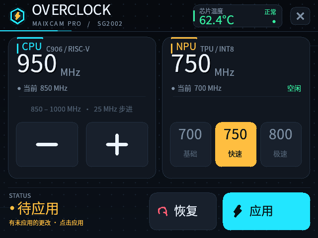
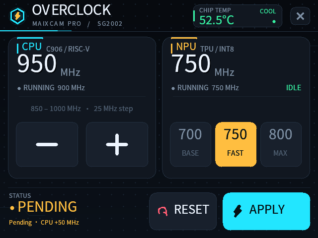
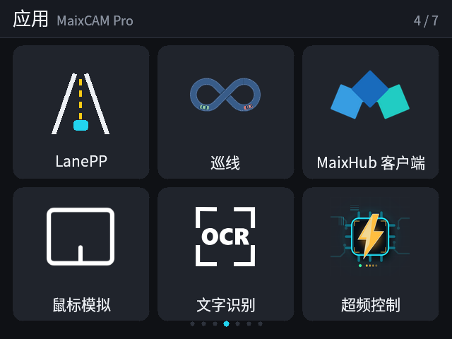

# Overclock — MaixCAM Pro CPU / NPU 超频与温度监控

一个面向 **MaixCAM Pro（SG2002 / LicheeRV Nano）** 的 MaixPy 应用：

- CPU 频率：**850 – 1000 MHz**，**25 MHz 步进**（850 / 875 / 900 / 925 / 950 / 975 / 1000）
- NPU 频率：**700 / 750 / 800 MHz** 三档
- 实时显示 **SoC 芯片温度**，并按温度自动变色
- 点击 **Apply** 才真正改频；**Reset** 一键恢复原厂 **CPU 850 MHz / NPU 700 MHz**
- 完整支持触摸、中英文界面、NPU 忙保护、错误提示与安全回退





应用图标（112×112，已适配新版启动器）：


在新版启动器中的实际显示效果：



---

## 1. 安装

把整个 `maixcam_overclock/` 目录传到设备（例如 `/root/maixcam_overclock/`），然后：

```sh
cd /root/maixcam_overclock
sh install.sh
```

安装脚本会：

1. 复制应用到 `/maixapp/apps/overclock/`；
2. 把两个内核模块放到应用的 `assets/modules/`；
3. 调用官方 `gen_app_info.py` 注册应用；
4. 把 112×112 图标复制到 `/maixapp/apps/launcher/icons/overclock.png`（新版启动器优先读取这里）；
5. 重启当前启动器 GUI，使新应用和图标立即出现。

安装后在启动器里点击 **Overclock / 超频控制** 即可。

卸载：

```sh
cd /root/maixcam_overclock
sh uninstall.sh
```

> 卸载不会自动改回频率。若当前正在超频，请先在应用内点 **Reset**，或重启设备。

---

## 2. 使用

### 主界面

| 区域 | 说明 |
|---|---|
| CPU 卡片 | 两个 **125×90** 的大按钮 `−` / `+`，每次 25 MHz；无滑杆、无拖动操作 |
| NPU 卡片 | 700 / 750 / 800 MHz 三个大按钮，显示 NPU 是否空闲 |
| 右上角 | 芯片温度与状态（COOL / WARM / HOT），界面中不再重复显示温度 |
| 左下角 | 状态区：READY / PENDING / APPLIED / FACTORY / ERROR |
| 右下角 | 大尺寸 **RESET** 和 **APPLY** 按钮 |
| 右上角 × | 退出应用，回到启动器 |

- **选择不会立即改频**，只有点 **Apply** 才会生效。
- 有未应用的修改时，状态区会显示 `PENDING` / `待应用`，并给出待应用的频率差。
- 关闭应用不会恢复默认，频率会保持到重启；重启后自动回到原厂设置。
- **Reset 会立刻恢复**，不需要再点 Apply；成功后状态区显示 `FACTORY` / `原厂设置`。
- 若 NPU 正在被 AI 应用/模型占用，NPU 会显示 `BUSY`，应用会拒绝改 NPU 频率，避免推理过程中改 PLL 导致挂死。

### 温度

读取 `/sys/class/thermal/thermal_zone0/temp`，每秒刷新一次，只显示在右上角：

- `< 65 °C`：绿色 / COOL
- `65 – 75 °C`：黄色 / WARM
- `≥ 75 °C`：红色 / HOT

---

## 3. 命令行工具（可选）

应用也提供不打开界面的命令行接口，便于安装验证和故障恢复：

```sh
cd /maixapp/apps/overclock

python3 main.py --status                  # 当前 CPU / NPU / 温度 / NPU 是否空闲
python3 main.py --set-cpu 900             # 只改 CPU
python3 main.py --set-npu 750             # 只改 NPU
python3 main.py --set-cpu 950 --set-npu 800
python3 main.py --reset                   # 恢复 CPU 850 / NPU 700
```

示例输出：

```text
CPU : 900 MHz
NPU : 750 MHz
TEMP: 53.5 °C
NPU_IDLE: True (enable_count=0)
```

非法频率（例如 CPU 860）会直接拒绝，不会加载模块。

---

## 4. 目录结构

```text
maixcam_overclock/
├── app.yaml                     # MaixPy 应用清单（中英文名称、图标）
├── main.py                      # 全部应用逻辑：UI + 频率控制 + CLI
├── assets/
│   ├── icon.png                 # 112×112 图标
│   └── modules/
│       ├── mpll_freq.ko         # CPU PLL 控制模块（预编译）
│       └── npu_freq.ko          # NPU PLL 控制模块（预编译）
├── preview/
│   ├── overclock_zh.png         # 中文界面截图
│   ├── overclock_en.png         # 英文界面截图
│   ├── launcher_icon.png        # 新版启动器中的实际显示
│   └── icon_448.png             # 图标放大预览
├── install.sh / uninstall.sh
├── tools/
│   └── make_icon.py             # 图标生成脚本
├── vendor/                      # 两个内核模块的 GPL 源码备份
│   ├── cpu/…
│   └── npu/…
└── README.md
```

---

## 5. 实现说明

### 5.1 CPU：MPLL

源码与预编译模块来自 `D:\Project\maixcam_cpu`：

- 时钟：`clk_mpll` → `clk_c906_0` → RISC-V C906
- 通过 `clk_set_rate(clk_mpll, target)` 改频，让厂商 PLL 驱动同时重算 `ictrl` 并等待 PLL 重锁
- 只改 CPU 的 MPLL，不碰 DDR / 显示 / 视频 / USB 时钟

### 5.2 NPU：TPLL

源码与预编译模块来自 `D:\Project\maixcam_npu`：

- 时钟：`clk_tpll` → `clk_tpu`（默认二分之一）→ NPU
- 模块读取当前 `tpll/tpu` 分频比，换算目标 `tpll` 后调用 `clk_set_rate(clk_tpll, …)`
- 改频前检查 `clk_tpu/clk_enable_count == 0`，要求 NPU 空闲

两个模块的源码、hash、vermagic 与重新编译方式见 [`docs/INTEGRATION.md`](docs/INTEGRATION.md)。

### 5.3 应用如何加载模块

每次点击 Apply / Reset：

1. 校验目标频率在允许集合内；
2. 读取当前实际频率；若目标与当前一致则跳过；
3. NPU 需要改频时，先确认 `clk_tpu` 的 enable_count 为 0；
4. `insmod <module> <param>=<hz> delay_ms=0`；
5. 轮询 `/sys/kernel/debug/clk/.../clk_rate`，最长 3.2 s，直到实际频率等于目标；
6. `rmmod` 卸载模块（频率保持不变）；
7. 再次读回频率校验，并刷新界面。

模块只在改频的几百毫秒内存在，不会常驻。失败时会自动尝试卸载模块，并保留内核日志的最后几行放在错误弹窗里。

### 5.4 为什么不需要改内核

MaixPy / MaixCDK 只提供 `cpu_freq()`、`npu_freq()` 读取接口，没有 setter；内核也没有 cpufreq/DVFS。这里复用已经验证过的两个内核模块，通过 `clk_set_rate()` 修改对应 PLL，不需要重新编译 MaixPy、改内核或烧录系统。

---

## 6. 已验证

在 MaixCAM Pro（Linux `5.10.4-tag-`，MaixPy 4.12.5）上实测：

- CPU 七个档位全部可达：850 / 875 / 900 / 925 / 950 / 975 / 1000 MHz；
- NPU 三档全部可达：700 / 750 / 800 MHz；
- 非法 CPU 860 被拒绝，频率不变；
- NPU 被 `model_runner` 占用时，改 NPU 被拒绝且原频率保持 700 MHz；
- Reset 后读回 CPU 850 MHz / NPU 700 MHz；
- 改频后 `/proc/modules` 中没有 `mpll_freq` / `npu_freq` 残留；
- 使用虚拟 `hyn_ts` 触摸设备做了完整 UI 链路测试：
  - 简化版界面下，只用大号 `−` / `+` 按钮把 CPU 从 900 → 925 → 950，NPU 选 750 → Apply → 读回 950/750 → Reset → 读回 850/700；
  - 退出后启动器自动恢复；
- 按 `launcher_daemon` 的真实启动方式启动（它会追加一个**空字符串** `start_param`）验证通过，不再出现 `argparse: unrecognized arguments`；
- 中英文界面、温度、状态区、Apply 忙碌遮罩、Reset 成功提示均在真实渲染路径下验证。

测试时芯片温度约 53–60 °C（空闲/轻度负载），没有出现 panic、oops 或显示异常。

---

## 7. 注意与风险

> 超频有风险，请自行评估稳定性。

- **没有电压联动**：这里只改 PLL 频率，不提高核心电压；1000 MHz / 800 MHz 不保证所有板子都长期稳定；
- **不持久**：重启后回到 CPU 850 MHz / NPU 700 MHz；
- **改频瞬间不要断电**：PLL 重锁期间（不到 1 秒）断电可能导致异常，但下次冷启动会重新配置默认频率；
- **NPU 必须在空闲时改频**：推理中改 TPLL 可能挂死；应用会检查 `clk_tpu` 的 enable_count，但无法覆盖所有驱动内部使用场景；
- **温度不是控制环**：应用只显示温度，不会自动降频；长期高温请改善散热；
- 内核版本必须匹配：模块 vermagic 为 `5.10.4-tag- preempt mod_unload riscv64`。升级系统后如模块无法加载，请用匹配的内核树重新编译（见 `docs/INTEGRATION.md`）；
- 若改频后出现异常，**断电重启**即可恢复出厂频率。

---

## 8. 图标

- 规格：**112×112 PNG，8-bit RGB，不透明**，背景与新版启动器卡片色 `#20242c` 融合；
- 位置：
  - 应用自身：`assets/icon.png`（`app.yaml` 引用）
  - 新版启动器：`/maixapp/apps/launcher/icons/overclock.png`
- 重新生成：

```sh
python3 tools/make_icon.py
```

需要 Pillow。脚本以 8× 超采样绘制芯片 + 闪电 + 电路纹理，再缩放为 112×112。

---

## 9. 兼容性

- 设备：MaixCAM Pro（SG2002，640×480 触摸屏）
- 系统：Buildroot / Linux 5.10.4-tag-，MaixPy 1.24.0 / 4.12.5
- 启动器：官方 daemon + 新版 MaixPy 启动器
- 需要 root：`launcher_daemon` 本身以 root 运行，因此从启动器打开时权限满足
